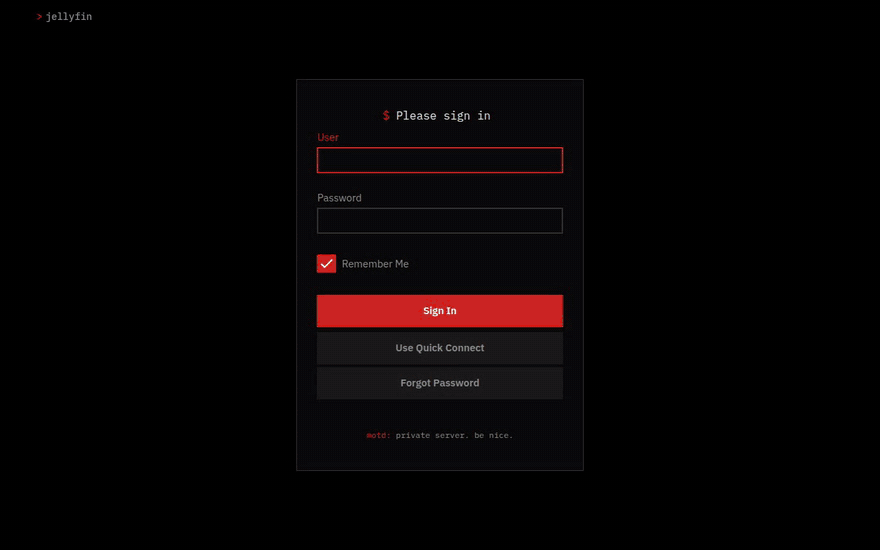
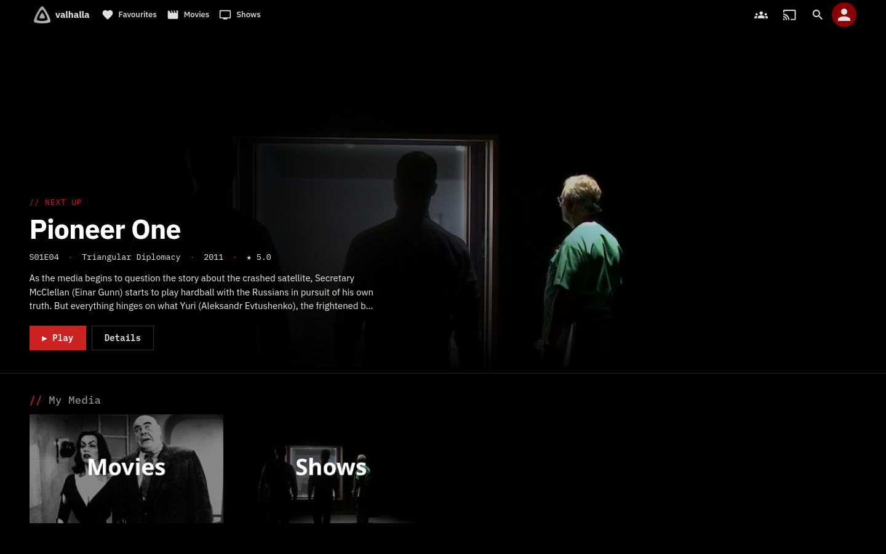
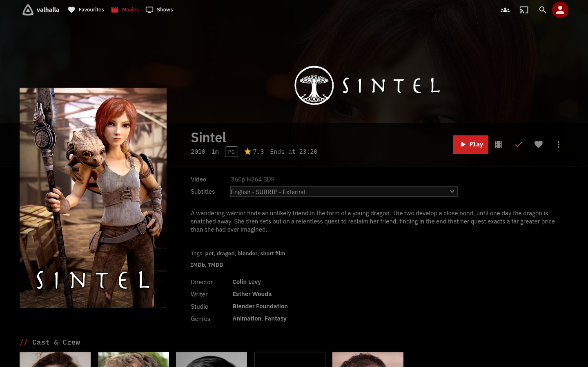
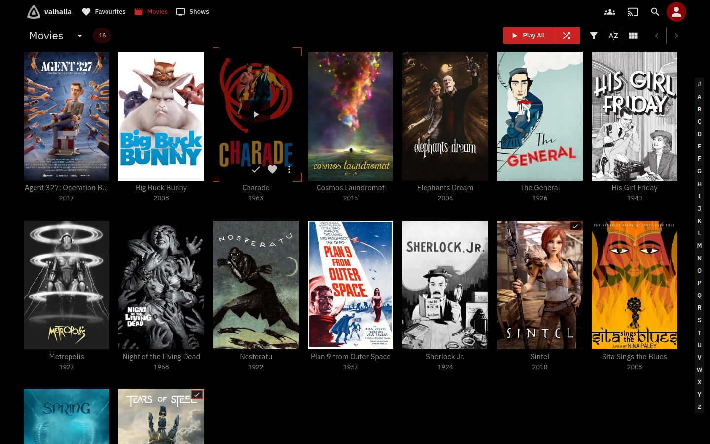
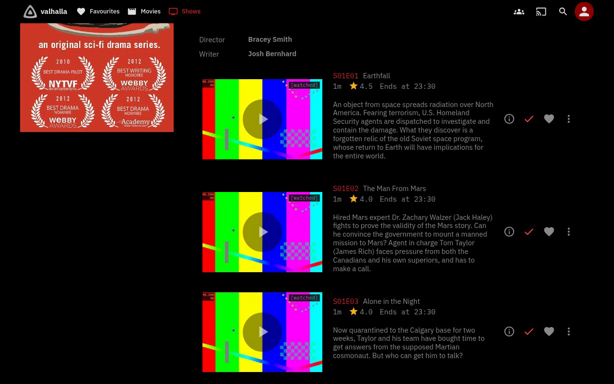
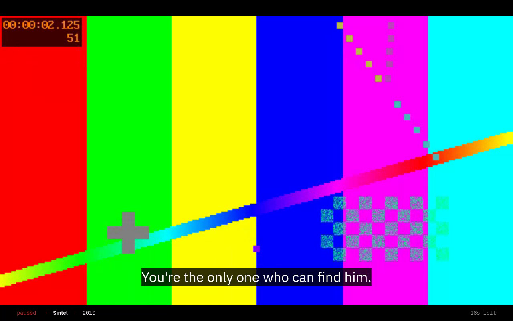
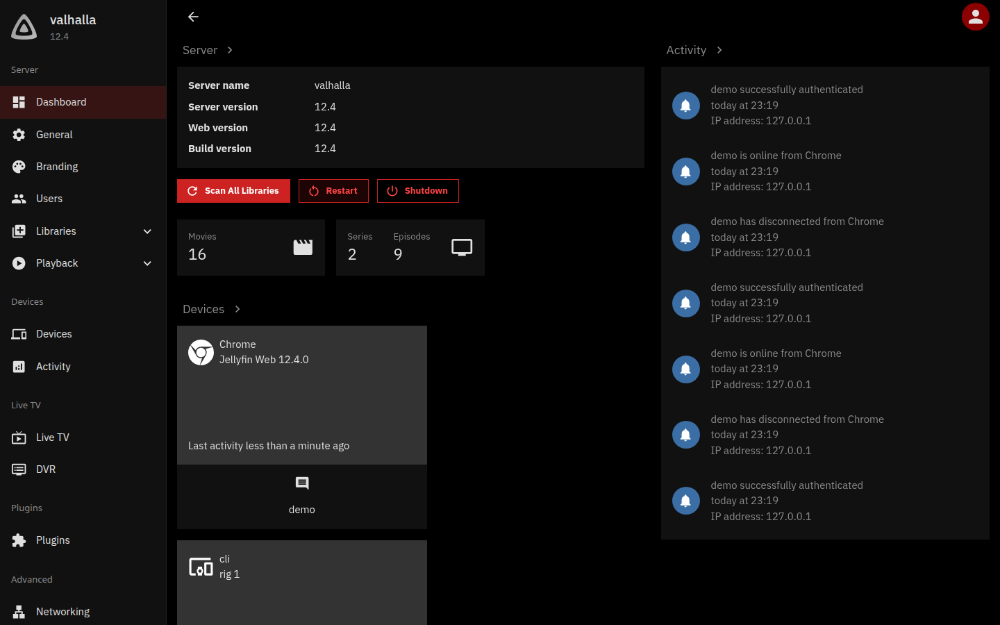
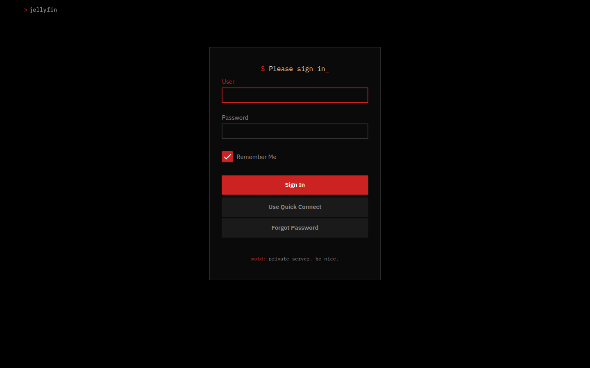
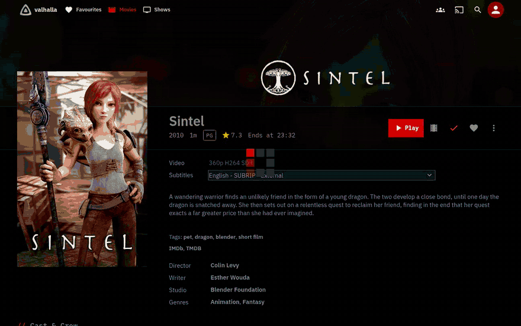
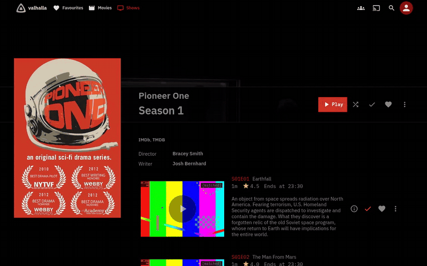

# cr1ms0nfin

An OLED black and red theme for [Jellyfin](https://jellyfin.org) 12: true
black backgrounds, one red accent, square corners, monospace details, and
short animations that feel like a terminal redrawing.



It comes in two parts:

- **`theme.css`** is the theme. Paste it into Custom CSS and you're done.
- **`cr1ms0nfin.js`** is optional and needs the
  [JavaScript Injector](https://github.com/n00bcodr/Jellyfin-JavaScript-Injector)
  plugin. It adds a hero banner to Home, a status line when you pause, a
  volume readout and episode numbers, and carries the theme onto the
  dashboard.

## Screenshots

| | |
|---|---|
|  |  |
|  |  |
|  |  |



### The player

Controls fade in and out together, the volume shows as a number, the seek
bar previews in a square frame, menus mark the current choice with a red
`>`, and once the controls hide while paused a single status line says
what's on.



### Lists and search



### Boot

With the [server-side splash](#the-boot-splash-optional-server-side)
installed, Jellyfin boots straight into black and the square loader.


## What it changes

- **Colour:** pure `#000` backgrounds for OLED screens and a single red
  accent. Jellyfin's stock blue is replaced everywhere it's hard-coded too:
  the player's seek and volume sliders, switches, spinners, progress bars,
  subtitle pills and placeholder cards. There's no green anywhere; "success"
  states use a cool blue instead.
- **Shape:** every corner is square: cards, buttons, dialogs, badges and inputs.
- **Type:** IBM Plex Sans for text and IBM Plex Mono for the details
  (runtimes, ratings, codecs, the A–Z picker, the player's clock).
- **Layout:**
  - Section titles read like code comments (`// Recently Added in Movies`)
    and library titles end in a blinking `_` cursor.
  - Sign-in is one narrow boxed panel with a `$ Please sign in_` prompt.
  - On a details page, Play becomes a solid red button labelled "Play", or
    "Resume" if you've started it.
  - The duplicate labels under the My Media tiles are hidden.
  - The Jellyfin logo is grey instead of its blue and purple gradient. On
    the sign-in page it becomes a `> jellyfin` prompt, and the login
    disclaimer (Dashboard → General) shows as a `motd:` line.
  - Watched and unplayed-count badges are small square mono tags, like the
    rating box on a details page. Episode rows show a dim `[watched]` tag
    instead of the tick circle.
  - Empty pages read `// nothing here_` and toasts look like terminal
    output with a red `>`. Search suggestions are dim mono rows; the
    hovered one gets a red `>`.
  - Restart, Shut down and other destructive buttons are outlined, so they
    stand apart from the solid red ones. Dashboard device cards are black
    with a red edge.
  - Cast and crew without a photo get a black frame reading `// no photo`.
  - Scrollbars are thin and black, and turn red under the pointer in Chrome.
- **Player:**
  - The controls sit on a flat black strip instead of a grey haze, and the
    top bar fades into the video with no line under it.
  - Hovering the seek bar shows the time, and the preview thumbnail when
    the library has them, in a square frame.
  - The quality, audio and subtitle menus are mono rows with a red `>` on
    the current choice.
  - Up Next is a boxed panel with a solid Start now button, and Skip Intro
    is a square mono button.
  - Subtitles default to white IBM Plex Sans on a black box. If you've set
    your own subtitle font or background in Jellyfin, yours is kept.
- **Motion:**
  - Home rows rise in one after another and section titles wipe in.
  - Hovering a card lifts it and closes red corner brackets around it.
  - A red bar slides in under the header link you hover.
  - The favourite heart beats once when you turn it on.
  - Backdrops settle in from slightly zoomed.
  - The loading circle becomes a square terminal spinner: a red head with a
    fading tail stepping round a 3×3 grid.
  - The player controls fade back in along with the top bar instead of
    popping.
  - All of it turns off when your system asks for reduced motion.

### With the script

- **Hero banner:** the top of Home shows whatever you were last watching,
  with its backdrop, logo, a progress bar, the time left and a Resume button.
  Episodes show the series art and `S01E02 · title`. If nothing is in
  progress it shows the next episode of a show you're partway through; on
  desktop it cycles through up to three of those, crossfading, with small
  squares to jump between them, and holds still while you're pointing at
  it. Failing that it shows an unwatched film or show, picked once per
  browser session so Home doesn't reshuffle every time you open it. Logos
  are cropped to their visible pixels, and dark ones are turned white so
  they show on black. On the TV layout, Down from the header and Up from
  the first row land on its Play button.
- **Paused:** once the controls hide, one mono line at the bottom says
  what's on: `paused_ · Pioneer One · S01E03 Alone in the Night · 8m left`.
- **Volume:** changing the volume shows the level as a number. Desktop
  browsers get no volume pop-up from Jellyfin at all, so the script draws
  one; on phones and TVs it adds the number to Jellyfin's.
- **Episode lists:** every episode title starts with its `S01E03`.
- **Dashboard:** Jellyfin deliberately leaves Custom CSS off its admin pages,
  so a broken theme can't lock you out. The script keeps a copy of your
  Custom CSS and applies it there too.

The script only talks to your own server, through Jellyfin's own
`window.ApiClient` (your logged-in session). It has no dependencies and no
tracking, and it's short enough to read before you install it.

## Install

### The theme

1. Open **Dashboard → General**, then **Custom CSS** (under Branding).
2. Paste the whole of [`theme.css`](theme.css), or just this line to always
   follow the latest version:

   ```css
   @import url("https://cdn.jsdelivr.net/gh/iamzainrizwan/cr1ms0nfin@main/theme.css");
   ```

3. Save and refresh. It works on top of any built-in user theme.

### The script (optional)

1. Install the JavaScript Injector plugin: **Dashboard → Plugins → Catalog
   → ⚙️ → ➕**, add the repository
   `https://raw.githubusercontent.com/n00bcodr/jellyfin-plugins/main/manifest.json`,
   then install **JavaScript Injector** from the catalogue and restart
   Jellyfin.
2. Open **JS Injector** in the dashboard sidebar and click **Add Script**.
3. Paste the whole of [`cr1ms0nfin.js`](cr1ms0nfin.js), tick **Enabled** and
   save.
4. Refresh the page.

Each feature can be switched off at the top of the script (`CONFIG`:
`hero`, `player`, `episodeNumbers`, `dashboard`).

### The boot splash (optional, server side)

Jellyfin shows its own logo and spinner before Custom CSS loads. To get the
themed loader and a black screen from the first frame, make the server load
Custom CSS early by adding one line to the web client's `index.html`:

```html
<link id="cr1ms0nfin-early" rel="stylesheet" href="../Branding/Css.css">
```

On the linuxserver Docker image, a container init script redoes this on
every start, so it survives updates. Save this as
`custom-cont-init.d/90-cr1ms0nfin-early` (owned by root), mount the folder
at `/custom-cont-init.d`, and recreate the container:

```bash
#!/usr/bin/with-contenv bash
f=/usr/share/jellyfin/web/index.html
grep -q 'id="cr1ms0nfin-early"' "$f" ||
    sed -i 's|</head>|<link id="cr1ms0nfin-early" rel="stylesheet" href="../Branding/Css.css"></head>|' "$f"
```

## Customise

Every colour comes from the tokens at the top of `theme.css`. To change
them, add your own values after the theme in Custom CSS:

```css
@import url("https://cdn.jsdelivr.net/gh/iamzainrizwan/cr1ms0nfin@main/theme.css");

:root {
    --oled-accent: #7c4dff;
    --oled-accent-rgb: 124 77 255;   /* the same colour as "r g b" */
    --oled-accent-bright: #a67cff;
    --oled-accent-dark: #4b2a9e;
}
```

The other tokens cover the greys (`--oled-bg`, `--oled-surface`,
`--oled-border`…), the fonts (`--oled-font`, `--oled-font-mono`), the corner
radius (`--oled-radius`, `0` by default) and the animation speeds.

## Compatibility

- Built and tested on Jellyfin 12.4 in the web client, in Chrome and
  Firefox. Jellyfin Media Player and the Android app use the same web
  client, so they get it too. Native apps (Android TV, Swiftfin, Findroid,
  Roku) don't read Custom CSS.
- Tested on the desktop, phone and TV layouts.
- "Play", "Resume", "Details" and the theme's own labels (`// nothing
  here`, `// no photo`, `motd:`, `paused`) are in English only.

## How it works

jellyfin-web 12 is built on MUI with CSS variables (prefix `jf`), and each
built-in theme sets its palette on `[data-theme="<id>"]`. The theme sets the
same variables on `:root[data-theme]`, which is more specific, so it wins
whichever theme a user has picked. The rest of `theme.css` covers what the
variables don't reach: hard-coded colours, shapes, layout and motion.

## License

[MIT](LICENSE)
